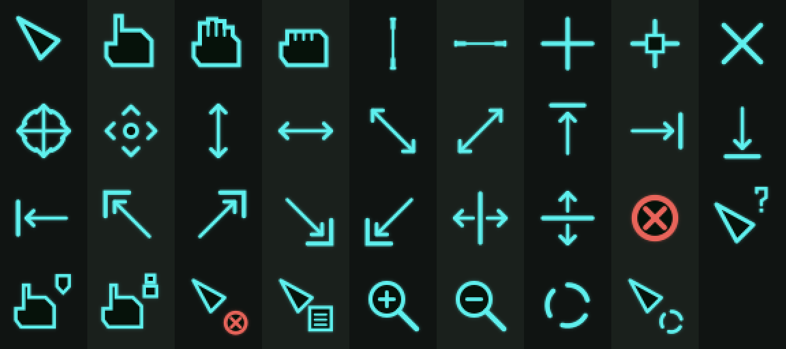

# White Rabbit extras

Everything that *runs* for the [White Rabbit](https://github.com/cycclon/omarchy-white-rabbit-theme) [Omarchy](https://omarchy.org/)
theme: a digital-rain screensaver, a CRT tube overlay, a phosphor bloom
shader, asymmetric cyan HUD window frames, a restyled menu and HUD cursors —
Kid's Story terminal, not a movie poster.

The theme itself — palette, backgrounds, GTK and shell colors — lives in
[omarchy-white-rabbit-theme](https://github.com/cycclon/omarchy-white-rabbit-theme) and installs on its own with
`omarchy theme install`. This repository adds the rest, and its
`install.sh` sets up both.


| The HUD menu | The digital-rain screensaver |
|---|---|
|  |  |

## What this is

The pieces, working together under one Hyprland session:

- the **theme** ([its own repository](https://github.com/cycclon/omarchy-white-rabbit-theme)) — palette, terminal, GTK, and
  shell-chrome colors, four background images, and the Hyprland config that
  ties the rest together (`hyprland.lua.example`); `install.sh` fetches it
- four **Quickshell plugins** (`plugins/cycclon.*`) that run inside your
  existing `omarchy-shell` process: the CRT overlay, the phosphor glow, the
  digital-rain screensaver, and a restyled Omarchy menu
- one **native Hyprland plugin** (`hud-borders/`), compiled C++, that draws
  the window frame
- a **mouse cursor set** (`cursors/`) in the same cyan HUD line-art

None of it is theme-engine configuration you could get from `colors.toml`
alone — the window frame, the CRT tube, the phosphor bloom, and the
screensaver are each a small program, which is why they live apart from the
theme.

## Features

- **The theme** ([separate repo](https://github.com/cycclon/omarchy-white-rabbit-theme)) — dimmed phosphor green on
  near-black with a desaturated cyan accent, tuned foot/GTK styling, shell
  chrome from the same `colors.toml`, and four digital-rain backgrounds.
- **HUD window frames** (`hud-borders`) — the whole frame is drawn in cairo,
  not Hyprland's built-in border, so the outline is not a rounded rectangle.
  Window content is shrunk to fit inside it, so the cuts and notches are
  genuinely see-through, and a window alone on a workspace becomes a centred
  16:9 panel.
  As shipped: 45° cuts top-left and bottom-right, square top-right and
  bottom-left corners, a notch stepped into the right edge and a smaller one
  low on the left, and a slanted gauge with trailing slashes riding the
  bottom line into the bottom-right cut. Corner ticks, a tab and a hatch
  block are available too, off by default.
- **HUD menu** (`cycclon.menu`) — Omarchy's Super+Space menu in the same
  frame language but its own shape: the right edge steps inward partway down
  and stays in, with a small gauge top-left. It powers on with a CRT flicker,
  collapses to a bright line when closed, and slides between submenus.
- **HUD cursors** (`cursors/`) — cyan line-art pointers, filled near-black so they read on light pages, with a soft
  glow: a triangular arrow, an angular pointing hand, a capped text beam, a
  four-way move cross with arcs, a red "forbidden" ring, and the full set of
  resize, zoom, help, copy and animated busy cursors. The pointer is drawn
  in software so the glow and scanlines reach it too.
- **CRT tube overlay** (`cycclon.crt`) — a fullscreen shader adding
  scanlines, corner vignette, and a faint black-level haze over everything,
  screensaver included.
- **Phosphor glow** (`cycclon.glow`) — installed as a genuine Hyprland
  `decoration:screen_shader`, so it blooms the *entire compositor output*:
  bright green pixels bleed light into their neighbors, scanline bands waver
  slightly like a real CRT beam, and per-glyph grain keeps the bloom from
  looking like a flat blur.
- **Digital-rain screensaver** (`cycclon.rain`) — the signature feature.
  Classic falling glyphs (halfwidth katakana, digits, and a little Latin and
  punctuation), each column independently timed. Every so often, several
  columns are nudged to land the same letters on the same row at the same
  instant, so a word or phrase reads across them for a couple of seconds
  under a subtle glow, then dissolves back into noise. The pool leans tech
  (`ARCH`, `LINUX`, `OMARCHY`, `SUDO`, `KERNEL PANIC`, …) and movie
  (`NEO`, `MORPHEUS`, `ZION`, `FOLLOW THE WHITE RABBIT`, …) — 95 entries
  shipped, plus your own (see [Configuration](#digital-rain-screensaver)).
  It renders *behind* the CRT and glow overlays, so both apply to it exactly
  as they do to everything else on screen, and it's multi-monitor aware.

## How it fits together

```
Hyprland
 ├─ hud-borders (native plugin, hyprctl plugin load)  → draws window frames
 ├─ decoration:screen_shader                          → phosphor glow (cycclon.glow)
 └─ layer-shell surfaces
     ├─ omarchy-bar                    (Top)
     ├─ omarchy-rain  (screensaver)    (Top, layer_rule order = -1: above the bar)
     └─ CRT overlay                    (Overlay: on top of everything, incl. rain)
```

The rain is a `Top`-layer surface, not `Overlay`, specifically so the CRT
overlay keeps compositing over it — an `Overlay`-layer screensaver would sit
*above* the CRT tube instead of inside it. The phosphor glow needs no layer
rule at all: `decoration:screen_shader` runs on the fully composited frame,
rain included. See `hyprland.lua.example` in the [theme repo](https://github.com/cycclon/omarchy-white-rabbit-theme) for the full comment trail; the sign
of Hyprland's `layer_rule order` (lower draws nearer the top) was arrived at
by measurement, not documentation.

## Requirements

**Tested on:** Omarchy 4.0.2, Hyprland 0.56.2, Quickshell 0.3.1, Qt 6.11.2 —
one machine, one GPU. Nothing here is intentionally version-pinned, but only
this combination has actually been run.

### Software
- **Omarchy**, Hyprland, Quickshell — the theme's shell chrome and Quickshell
  plugins depend on Omarchy's plugin system; nothing here targets a bare
  Hyprland + Quickshell setup or another compositor.
- **`noto-fonts-cjk`** — the rain's halfwidth-katakana glyphs come from Noto
  Sans CJK. Without it, the affected glyphs fall back to whatever your
  system substitutes (typically empty boxes) — the rain still runs, just
  less authentically. `sudo pacman -S noto-fonts-cjk`.
- **`yaru-icon-theme`** — named by `icons.theme`. Purely cosmetic;
  skip it and GTK apps keep whatever icon theme you already had.
- **To build `hud-borders`** (optional, see [Limitations](#limitations--drawbacks)):
  a C++23 compiler, `cairo`, `pixman-1`, `libdrm`, `pangocairo`, `libinput`,
  `libudev`, `wayland-server`, `xkbcommon` development headers, and
  Hyprland's own headers (`hyprland.pc` — Arch's `hyprland` package ships
  them; elsewhere, `hyprpm update` if your Hyprland still has it).
- **`gum`** — used for install-script prompts if present; the script falls
  back to plain `read -p` without it.

### Hardware
Nothing exotic — if your GPU already runs Hyprland's `decoration:blur` and
`decoration:shadow` comfortably, it will run this. Rough cost, measured on
the dev machine at 2560×1440 / 60 Hz:
- the rain, while showing: ~5% of one CPU core (its own tick is coalesced to
  60 Hz regardless of your panel's refresh rate; cost scales with screen
  resolution and the `size` setting, since that sets the glyph grid density)
- CRT overlay and phosphor glow: both full-screen fragment shaders, cost
  scales with output resolution the same way `decoration:blur` does
- `hud-borders`: a cairo-rendered texture per window, re-rendered on
  focus/size/config change — cheap for tiled use; see
  [Limitations](#limitations--drawbacks) for the one case (live-resizing a
  large floating window) where it's rendering every frame instead

## Limitations & drawbacks

- **`hud-borders` links Hyprland's internal API, not a stable plugin ABI.**
  A Hyprland update *will* eventually stop it from loading until it's
  rebuilt (`hud-borders/rebuild.sh`). The ABI check hashes Hyprland's commit
  *plus the versions of its dependency libraries* (aquamarine, hyprutils,
  …), so a distro upgrade of just one dependency can break the plugin even
  when the Hyprland version is unchanged. The rebuild script handles this:
  it builds against the distro's own `hyprland.pc` headers (always in
  lockstep with the running binary), and only on distros that don't ship
  them falls back to hyprpm's header cache, which it checks and repairs
  before building. This is the single most fragile piece of the whole theme.
- **Without `hud-borders` loaded, windows have no visible border at all.**
  `hyprland.lua.example` sets `border_size = 0` on the assumption that the
  native plugin is drawing the frame instead. If you skip building it, or a
  Hyprland update breaks it and you haven't rebuilt yet, restore a plain
  border by setting `general.border_size = 2` in your
  installed `~/.config/omarchy/themes/white-rabbit/hyprland.lua` (`install.sh`
  warns you about this every time it can't load the plugin).
- **Everything here runs unsandboxed.** The Quickshell plugins are
  plain QML/JS loaded straight into your always-on `omarchy-shell` process —
  this is how every Omarchy plugin works, not something specific to this
  theme, but it's worth restating: read the code before you run it.
- **It's a lot of full-screen shader work stacked at once** — window blur and
  shadow (Hyprland's own), the CRT tube, the phosphor screen shader, and,
  while it's showing, the rain's shader. Each is individually cheap; on an
  older or integrated GPU the stack is where you'd notice it, especially if
  you've also turned up `decoration:blur` size/passes elsewhere.
- **Hidden words are plain ASCII only.** The reveal mechanism aligns letters
  from the glyph pool (Latin, digits, a little punctuation); it doesn't
  attempt accented characters or non-Latin scripts. Noto CJK is used for the
  *background noise* katakana, not for spellable hidden text.
- **The screensaver's idle timer is its own**, separate from Omarchy's
  `idle.screensaver` / `idle.lock` in `shell.json` (though it defaults to
  following `idle.screensaver` — see `idleSeconds` below). It coexists with,
  doesn't replace, your system lock timer. If you have Omarchy's "stay awake"
  toggle on, the screensaver won't fire on its own — `omarchy-shell rain
  status` says so explicitly.
- **The window-blur tuning assumes the shipped backgrounds.** `hyprland.lua`
  pushes blur `brightness`/`contrast`/`vibrancy` to keep green rain legible
  *through* frosted glass. Swap in your own background and those numbers
  will likely need retuning.
- **Hyprland-only.** `layer_rule`, `decoration:screen_shader`, and a plugin
  built against Hyprland's internal API are all Hyprland-specific; nothing
  here targets another compositor.

## Install

```sh
git clone https://github.com/cycclon/omarchy-white-rabbit-extras ~/.local/src/omarchy-white-rabbit-extras
cd ~/.local/src/omarchy-white-rabbit-extras
./install.sh
```

Keep the clone where it lands (`hud-borders` is loaded from it at every
login, and `rebuild.sh` lives there). Updating is:

```sh
cd ~/.local/src/omarchy-white-rabbit-extras
git pull
./install.sh
```

`install.sh` is safe to re-run — every step replaces its own previous copy
rather than merging. It:

1. fetches the [theme](https://github.com/cycclon/omarchy-white-rabbit-theme) (a shallow `git clone` into a temporary
   directory, or the checkout you pass with `--theme-src DIR`) and copies it
   to `~/.config/omarchy/themes/white-rabbit/`, installing
   `hyprland.lua.example` and `foot.ini.example` as `hyprland.lua` and
   `foot.ini`
2. copies `plugins/cycclon.{crt,glow,rain}/` to
   `~/.config/omarchy/plugins/` and enables each one in the running shell,
   then asks whether to install `cycclon.menu` in place of the built-in menu
3. asks whether to build and load `hud-borders` (against the Hyprland headers
   your distro ships; Arch's `hyprland` package includes them); on success it
   adds a load hook to `~/.config/hypr/autostart.lua` (backed up first) — on
   failure or if you decline, it tells you how to restore a plain border
4. asks whether to install the cursors to `~/.local/share/icons/WhiteRabbit`
   (and points GTK's `cursor-theme` setting at them)
5. applies the theme (`omarchy theme set white-rabbit`) and restarts the shell

Flags: `--yes` skips every prompt, `--no-hud-borders` skips the native
plugin entirely (plain Hyprland border rendering — see Limitations),
`--no-menu` keeps Omarchy's built-in menu, `--no-cursors` keeps your
current mouse cursors, `--theme-src DIR` uses a local theme checkout
instead of fetching one.

> **Already installed the theme with `omarchy theme install`?** That gives you
> the palette, GTK and shell colors, and the backgrounds, with Omarchy's
> standard window borders: Omarchy deliberately drops `hyprland.lua` and any
> terminal config from a git-cloned theme. Running `install.sh` here replaces
> that clone with a plain copy that includes them, which the window frame,
> layer rules, blur tuning, screensaver, CRT overlay and glow all need.

### Doing it by hand

If you'd rather review each step yourself instead of running the script:

```sh
# 1. theme (from a clone of the theme repo, not a copy under ~/.config/omarchy/themes)
git clone https://github.com/cycclon/omarchy-white-rabbit-theme ~/.local/src/omarchy-white-rabbit-theme
mkdir -p ~/.config/omarchy/themes/white-rabbit
( cd ~/.local/src/omarchy-white-rabbit-theme &&
  cp -r backgrounds colors.toml gtk.css gtk4.css icons.theme preview.png shell.*.toml \
    ~/.config/omarchy/themes/white-rabbit/ &&
  cp hyprland.lua.example ~/.config/omarchy/themes/white-rabbit/hyprland.lua &&
  cp foot.ini.example     ~/.config/omarchy/themes/white-rabbit/foot.ini )

# steps 2-4 run from this checkout

# 2. plugins
cp -r plugins/cycclon.crt  ~/.config/omarchy/plugins/cycclon.crt
cp -r plugins/cycclon.glow ~/.config/omarchy/plugins/cycclon.glow
cp -r plugins/cycclon.rain ~/.config/omarchy/plugins/cycclon.rain
omarchy-shell shell rescanPlugins
omarchy plugin enable cycclon.crt
omarchy plugin enable cycclon.glow
omarchy plugin enable cycclon.rain
# optional: the HUD menu, replacing the built-in one
cp -r plugins/cycclon.menu ~/.config/omarchy/plugins/cycclon.menu
omarchy-shell shell rescanPlugins
omarchy plugin enable cycclon.menu

# 3. hud-borders (optional — skip for a plain border)
( cd hud-borders && ./rebuild.sh )
# The script finds headers itself: the distro's hyprland.pc if the package
# ships one (Arch does), else hyprpm's cache (which it checks and repairs).
# then add to ~/.config/hypr/autostart.lua:
#   hl.on("hyprland.start", function()
#     hl.exec_cmd("hyprctl plugin load " .. os.getenv("HOME") .. "/.local/src/omarchy-white-rabbit-extras/hud-borders/hud-borders.so")
#   end)

# 4. cursors (optional)
mkdir -p ~/.local/share/icons
cp -a cursors/WhiteRabbit ~/.local/share/icons/WhiteRabbit
gsettings set org.gnome.desktop.interface cursor-theme WhiteRabbit

# 5. apply
omarchy theme set white-rabbit
omarchy restart shell
hyprctl setcursor WhiteRabbit 24
```

### Uninstall

```sh
cd ~/.local/src/omarchy-white-rabbit-extras
omarchy theme set <some-other-theme>   # can't remove the active theme
./uninstall.sh
```

Removes the theme, the plugins (restoring the built-in menu), the cursors, and the `hud-borders` autostart hook.
Doesn't delete this checkout — remove the directory yourself once you're done.

## Configuration

### Theme colors & shell chrome

The palette and per-surface shell colors are plain theme files, documented in
the [theme repo's README](https://github.com/cycclon/omarchy-white-rabbit-theme#configuration). Edit them under
`~/.config/omarchy/themes/white-rabbit/` and re-run
`omarchy theme set white-rabbit` to apply.

### Cursors (`cursors/`)



`cursors/WhiteRabbit/` is a ready-built XCursor theme (sizes 24–96, with
animated busy cursors); anything it doesn't define falls back to Adwaita.
The theme's `hyprland.lua` selects it with `XCURSOR_THEME` and sets
`cursor.no_hardware_cursors = 1`, which renders the pointer in software so
the phosphor glow and scanlines apply to it. That can add a hair of pointer
latency; set it back to `2` if you notice it. Apps that were already open
pick the new cursors up the next time they start.

The cursors are drawn as SVG by `cursors/gen.py` — edit the shapes or the
`CYAN` / `RED` colors there and rebuild with (needs Python with `numpy` and
`pillow`, plus ImageMagick):

```sh
cd cursors && python3 gen.py WhiteRabbit/cursors
```

### HUD window frame (`hud-borders`)

Config lives under `plugin.hud_borders` in the theme's `hyprland.lua.example` (installed as
`~/.config/omarchy/themes/white-rabbit/hyprland.lua`):

| Key                                    | Meaning                                   |
|------------------------------------------|--------------------------------------------|
| `outer_thickness` / `inner_thickness` / `gap` | the two-line frame: hairline, dark gap, main line |
| `col.active` / `col.inactive`             | main line color, focused / unfocused        |
| `col.outer_active` / `col.outer_inactive` | hairline color                              |
| `fit_content`                             | shrink window content clear of every cut and notch, so they show what is behind the window. The insets are worked out from the notch and cut sizes (and the gauge); `col.mask` fills the band between the content and the frame. On in the shipped config |
| `col.mask`                                | with `fit_content`, the panel band around the content; without it, painted over window content inside the cuts and notches. Should match your window background |
| `chamfer_top_left/top_right/bottom_right/bottom_left` | corner cut depth, per corner (0 = square) |
| `notch_right_start`, `notch_right_length`, `notch_right_depth` | notch in the right edge: start and length as % of window height (length includes both slopes), depth in px (0 = off) |
| `notch_left_start`, `notch_left_length`, `notch_left_depth` | the same on the left edge |
| `gauge`, `gauge_start`, `gauge_height`, `gauge_inset` | slanted bar inside the bottom line: on/off, start as % of window width, height and distance from the line in px |
| `gauge_fill`, `gauge_length`                | stretch the bar until the last slash stops one gap short of the bottom-right cut, or use a fixed length |
| `gauge_stripes`, `gauge_stripe_width`, `gauge_gap` | the slashes trailing the bar          |
| `ticks`, `tick_length`, `tick_inset`      | small marks along the frame                 |
| `tab`, `tab_length`                       | the bar across the top-right cut            |
| `hatch`, `hatch_count`, `hatch_size`      | diagonal hatch block, bottom-right corner   |

Full detail, including the resize-cost caveat and the plain-border fallback,
is in `hud-borders/README.md`.

`decoration:rounding` is `0` on purpose: Hyprland rounds window content the
same amount at every corner, so any rounding would notch the square corners.
Hyprland's own shadow is off too: it follows the window's rectangle, so it
outlined the cuts and notches instead of the frame.

**A lone window** on a workspace is shown as a centred 16:9 panel with 50px
above and below (a `w[tv1]` workspace rule plus `single_window_aspect_ratio`),
so its outline stays visible. Open a second window and the normal tiling and
gaps return. Both settings are at the end of `hyprland.lua.example`.

### HUD menu (`cycclon.menu`)

A copy of Omarchy's built-in menu with its own frame and animations. Enabling
it replaces the built-in menu; disabling or removing it brings the built-in
one back. It is a snapshot of Omarchy's menu code, so menu features added by
later Omarchy releases only arrive here when this repo is updated.

- Outline, step and gauge: the properties at the top of
  `plugins/cycclon.menu/HudFrame.qml` (`chamferTL`…`chamferBL`, `stepStart`,
  `stepDepth`, `gauge*`). Line thicknesses follow `hud-borders`' settings when
  it is loaded.
- Animations: the `powerOn`, `powerOff` and `slideAnim` blocks in
  `plugins/cycclon.menu/Menu.qml`.

Sub-component edits need `omarchy restart shell` to take effect.

### CRT overlay (`cycclon.crt`)

Runtime-tunable over Quickshell IPC; settings persist to
`~/.local/state/omarchy/crt-settings.json`.

```sh
omarchy-shell crt status
omarchy-shell crt set <key> <value>
omarchy-shell crt toggle
omarchy-shell crt reset
```

| Key        | Default | Range   | Meaning                                  |
|------------|---------|---------|--------------------------------------------|
| `pitch`    | 3       | 2 – 8   | rows between scanlines (2 = fine, 8 = chunky) |
| `scan`     | 0.40    | 0 – 1   | scanline band darkness (0 = off)            |
| `vignette` | 0.36    | 0 – 1   | corner darkening (0 = off)                  |
| `haze`     | 0.030   | 0 – 0.2 | green floor mixed into the blacks (0 = off) |
| `strength` | 1.0     | 0 – 2   | master translucency (0.5 = subtle, 2 = heavy) |

### Phosphor glow (`cycclon.glow`)

Same pattern, persisted to `~/.local/state/omarchy/glow-settings.json`:

```sh
omarchy-shell glow status
omarchy-shell glow set <key> <value>
omarchy-shell glow toggle
omarchy-shell glow reset
```

| Key         | Default | Meaning                                             |
|-------------|---------|------------------------------------------------------|
| `bloom`     | 0.9     | glow strength (0 = off, 2 = heavy)                    |
| `warp`      | 0.35    | scanline band waver amplitude, in px (0 = off)        |
| `pitch`     | 3.0     | rows per scanline band                                |
| `threshold` | 0.20    | green+brightness cutoff for what blooms               |
| `grain`     | 0.35    | per-glyph glow unevenness (0 = even, 1 = wild)        |
| `cell`      | 15.0    | glyph cell height in px — sets the grain grid scale   |

This installs itself as Hyprland's `decoration:screen_shader`, so it affects
the whole compositor output, not just Quickshell surfaces. It hands the
shader slot back automatically the moment you switch to a different theme.

### Digital-rain screensaver (`cycclon.rain`)

Persisted to `~/.local/state/omarchy/rain-settings.json`:

```sh
omarchy-shell rain status         # armed/showing, current settings
omarchy-shell rain set <key> <value>
omarchy-shell rain toggle         # arm/disarm entirely
omarchy-shell rain start          # show it right now
omarchy-shell rain stop           # dismiss it right now
omarchy-shell rain word "TEXT"    # force TEXT to align soon
omarchy-shell rain words          # list the effective word pool
omarchy-shell rain reset
```

| Key         | Default | Range      | Meaning                                             |
|-------------|---------|------------|-------------------------------------------------------|
| `size`      | 17      | 8 – 48     | glyph size in px — drives the whole column/row grid   |
| `speed`     | 1.0     | 0.2 – 4    | fall-speed multiplier                                 |
| `wordEvery` | 26      | 4 – 600    | mean seconds between hidden-word reveals              |
| `glow`      | 0.10    | 0 – 1      | bloom strength around an aligned word (0 = letters only) |
| `reveal`    | 0.55    | 0.1 – 4    | how long a reveal lasts, in seconds                   |
| `dim`       | 1.0     | 0.1 – 2    | master brightness                                     |
| `vertical`  | 0.28    | 0 – 1      | share of reveals written down a single column instead of across a row |
| `idle`      | 0       | 0 – 86400  | seconds of idle before showing; `0` follows `idle.screensaver` in `~/.config/omarchy/shell.json` instead |
| `builtins`  | on      | on/off     | include the 95 shipped words alongside your own        |

Dismissed by any key press, mouse movement/click, or `rain stop`.

#### Adding your own words

Edit `~/.config/omarchy/branding/rain-words.txt` — created with a commented
template on first run. One word or phrase per line; `#` comments and blank
lines are ignored. **The file is watched and hot-reloads on save** — no
restart needed.

Entries are folded into the rain's own alphabet: upper-cased, apostrophes
dropped, anything else that isn't a letter, digit, or space becomes a space,
duplicates are dropped, and anything wider than the screen or over 48
characters is skipped rather than truncated. So `Don't follow the herd`
becomes `DONT FOLLOW THE HERD`.

Use spaces in phrases — the columns under a space keep raining normally
rather than freezing into an obvious block, which is most of what keeps a
long phrase hard to spot. Run `omarchy-shell rain set builtins 0` to use only
your own list.

## Development

`plugins/cycclon.rain/Preview.qml` is a standalone dev harness — run the
rain without the shell plugin machinery around it. Two things that will trip
you up if you go poking at the QML/JS yourself:

- **Qt routes `console.log`/warnings to journald, not your terminal.** Run
  with `QT_FORCE_STDERR_LOGGING=1` to see them where you're looking.
- **`omarchy-shell shell rescanPlugins` only reloads the entry point.**
  Sub-component files (`RainScene.qml`, `RainModel.js`, the shaders) are
  cached per-file; edits there need `omarchy restart shell` to actually take.

Shaders are pre-compiled `.qsb` (Qt Shader Baker) for portability across
graphics backends. Rebuild after editing a `.frag`/`.vert`:

```sh
/usr/lib/qt6/bin/qsb --glsl "100 es,120,150" --hlsl 50 --msl 12 shaders/rain.frag -o shaders/rain.frag.qsb
```

## Contributing

Forking, cloning, and running your own modified copy needs no permission --
the license already grants that. Pull requests are welcome and reviewed, but
go through the maintainer before anything is merged. See
[CONTRIBUTING.md](CONTRIBUTING.md) for what makes a PR easy to say yes to.

## Credits

- [Omarchy](https://omarchy.org/) and its plugin/shell architecture, which
  everything here is built on top of.
- The window-frame technique (cairo → `CGLTexture` → `renderTexture`) follows
  the same approach [`hyprbars`](https://github.com/hyprwm/hyprland-plugins)
  uses for its title bars.

## License

MIT — see [LICENSE](LICENSE). Contributions are accepted under the same
license.
